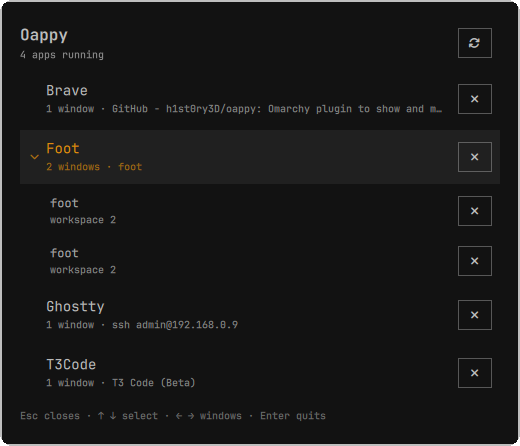

# Oappy

Oappy lists the apps that have a window open and puts an X on every row. Click
the X and that app quits. An app with several windows opens into one row per
window, and each window row has its own X.

The panel opens from the chart icon in the bar, or with `SUPER + ALT + ESCAPE`,
and appears in the middle of the focused monitor. It copies the macOS Force Quit
window.



## Why the list comes from Hyprland

The panel asks Hyprland for its clients and groups the windows by app class. An
app is on the list because it has a window on screen. `ps` would return hundreds
of processes, and almost none of them are apps a person wants to quit.

Grouping decides what the X does. Two Brave windows are one row, and that row
quits Brave. A row per window would leave the app running after the click, which
looks like a broken button.

The row name comes from the process name (`ps -o pid=,comm=`). When the process
name belongs to a runtime instead of an app, the panel uses the window class.
Obsidian reports `electron` as its process, so the row reads Obsidian.

## What the X sends

The two kinds of row quit in different ways, and that is the point.

A window row closes its window through Hyprland, with the same call `SUPER + W`
makes. The app decides what happens: it can save, ask a question, or close one
window and keep the rest. Two windows of one process can be closed one at a
time this way, which is how a browser window goes away without the browser
following it.

An app row is the last resort. It sends SIGTERM to every process behind the app,
waits 1.5 seconds, then sends SIGKILL to whatever still runs. An app that
handles SIGTERM closes and saves. An app that ignores it is killed anyway.
`TERM_GRACE_SECONDS` in `Apps.js` sets the wait. The script refuses pid 0 and
pid 1.

So: use the window row to close a window, and the app row when the app stopped
answering.

## Keyboard

| Key | Action |
|---|---|
| `↑` `↓` | move the selection |
| `→` | open the selected app into its windows, then step into the first one |
| `←` | close the app, or leave a window row and return to its app |
| `Page Up` / `Page Down` | move five rows |
| `Home` / `End` | first and last row |
| `Enter` or `Delete` | close the selected window, or force quit the selected app |
| `R` | read the list again |
| `Esc` | close the panel |

The first row is selected when the panel opens, because a shortcut opens it and
the keyboard is already in use.

The list re-reads every two seconds while the panel is open. An app started or
closed behind the panel appears without reopening it. A read that arrives while
another read runs is queued.

## One app, several windows

An app with more than one window shows a small arrow. Press `→` or click the
arrow and the app opens into one row per window, each with its own X and the
workspace the window is on. `←` closes the app again.

The window row's X closes that window and nothing else, even when several
windows belong to one process. The app row's X force quits the whole app. When a
close does nothing because the app is not answering, the app row is the way out.

## Install

The plugin is not in the Omarchy marketplace yet. Clone it and link it in:

```bash
git clone https://github.com/h1st0ry3D/oappy "$HOME/github/oappy"

# Relative target, so the link survives a different username or home directory.
ln -sfn ../../../github/oappy "$HOME/.config/omarchy/plugins/h1st0ry3d.oappy"

omarchy plugin enable h1st0ry3d.oappy --section right
omarchy restart shell
```

`--section right` puts the chart icon on the bar. Without it the plugin is
enabled but has no bar entry, and only the shortcut opens the panel. The panel
and the bar button are one plugin, so enabling it either way is enough for both.

The bar icon opens the panel and a second click closes it. It sends the same IPC
call the shortcut sends, so both routes behave the same and the panel follows
the focused monitor.

Adjust the number of `../` segments if you clone somewhere else, or use an
absolute path.

To install your own fork beside this one, rename the symlink and the `id` in
`manifest.json`. The plugin id is the only name the shell uses.

## The shortcut

The plugin does not install a keybinding. Add one to
`~/.config/hypr/bindings.lua`:

```lua
o.bind("SUPER + ALT + ESCAPE", "Force quit apps", "omarchy-shell shell toggle h1st0ry3d.oappy")
```

`SUPER + ESCAPE` already opens the system menu, so this binding adds ALT. That
gives the same chord as macOS, with SUPER in place of Command.

The binding sends an IPC call to the running shell, so no second Quickshell
process starts. To test the panel without the keybinding:

```bash
omarchy-shell shell toggle h1st0ry3d.oappy
```

## Requirements

| Program | Why |
|---|---|
| `hyprctl` (ships with Hyprland) | the list of open windows, and closing one window |
| `ps` (procps-ng) | the app names |
| `kill` (coreutils) | the quit itself |

There is no CLI, no config file, and no state on disk. The panel draws what
Hyprland reports at that moment.

## Troubleshooting

If the shortcut or the bar icon does nothing, check that the plugin is enabled
and that the shell has discovered it:

```bash
omarchy plugin list | grep oappy
omarchy-shell shell listPlugins
```

After you add the symlink, run `omarchy restart shell` once so the shell sees the
plugin. Later edits need no restart, because plugin code reloads on save.

If the line under the title says "hyprctl did not answer in time.", run
`hyprctl clients -j` in a terminal and read the error it prints.

If one app appears on two rows, Hyprland reports two window classes for it, and
some apps do that per profile. Both X buttons quit the same binary.

If a quit does nothing, the process belongs to another user and your session
cannot signal it. The line under the title reports the failure.

A bar widget file cannot be named `BarWidget.qml`. That name collides with
`qs.Ui.BarWidget`, and the shell refuses to load the widget with "File name case
mismatch". That is why the icon lives in `OappyBar.qml`.

After you edit `Apps.js`, run `omarchy restart shell`. The shell reloads
`Oappy.qml` when you save it, but it caches imported JavaScript for the life of
the process, so a changed helper file needs the restart.

## Files

| File | Contents |
|---|---|
| `manifest.json` | the shell's contract: one bar widget, one overlay, kept loaded |
| `OappyBar.qml` | the bar icon that opens the panel |
| `Oappy.qml` | the panel: processes, layout, keyboard |
| `Apps.js` | parsing, grouping, and the kill script, with no I/O |
